# TurtleBot3 Navigation and Visual Docking

**41014 Sensors and Control in Mechatronics Systems — Integrated Project, Track A**

| Submission information | Details |
|---|---|
| Group number | 55 |
| Team members | Harrison Braund; Noah Pereira |
| Demonstration video | 
| Source code | [GitHub repository](https://github.com/htek0956/41014_integrated_project) |

## Project overview

This project integrates sensing, state estimation and feedback control on a
TurtleBot3 Waffle Pi in MuJoCo. The robot follows a route through a simulated
indoor environment, detects obstacles using LiDAR, plans local detours and
returns to an ArUco-marked charging station for visual docking.

Wheel encoders and camera observations provide the robot's pose estimate.
Navigation and path tracking use this estimate; simulator ground truth is
reserved for evaluation and explicitly labelled calibration experiments.
Docking uses camera observations of the charging-station marker.

The submission covers simulation only. Docking demonstrates camera-based
positioning and stopping at the station; electrical charging is not simulated.

## Demonstration video

**TODO: insert the video link here when uploaded.**

The [five-minute script and asset list](submission/VIDEO_SCRIPT.md) are prepared.
Recording and upload remain outstanding. The video must include a current varied
or disturbed trial as well as nominal navigation, docking and uncertainty plots.

## Installation and running

The development environment uses **Python 3.14.6 on Windows**. Package versions
are listed in [requirements.txt](requirements.txt). The instructions below are
for PowerShell, starting in the folder where you want to download the project.
Installation from this file was verified in a separate clean Python 3.14.6
environment on the same Windows machine: all 33 tests, including short rendered
simulations, and the model checks passed. Full-length trials below used the
original development environment. [Saved test output](submission/verification.txt).

```powershell
git clone https://github.com/htek0956/41014_integrated_project.git
cd 41014_integrated_project
python -m venv .venv
.\.venv\Scripts\python.exe -m pip install -r requirements.txt
```

Start the demonstration with the simulation viewer:

```powershell
.\.venv\Scripts\python.exe scripts/main.py
```

Run without the display windows:

```powershell
.\.venv\Scripts\python.exe scripts/main.py --headless
```

Save each final trial separately (these commands use the existing plotting functions):

```powershell
.\.venv\Scripts\python.exe scripts/main.py --headless --seed 42 --output figures/submission/nominal_repeat
.\.venv\Scripts\python.exe scripts/main.py --headless --seed 42 --camera-dropouts --output figures/submission/dropouts
.\.venv\Scripts\python.exe scripts/main.py --headless --seed 43 --output figures/submission/layout_43
.\.venv\Scripts\python.exe -m unittest discover -s testing -p "test_*.py"
.\.venv\Scripts\python.exe scripts/model_analysis.py
```

The nominal, camera-outage and changed-layout trials all completed. All **33
existing tests pass**, the model rank checks pass, and `pip check` reports no
broken dependencies. See [remaining submission work](submission/SUBMISSION_NOTES.md).

The current demonstration uses obstacle seed **42**, with cube side lengths
sampled between **0.30 and 0.40 m**, to make the layout repeatable. Settings are
in [scripts/main.py](scripts/main.py), and obstacle generation is in
[scripts/add_obstacles.py](scripts/add_obstacles.py). Starting a run updates the
room-cube geometry in `robotis_tb3/scene_loop.xml`.

Selected plots and numerical reports are saved in `figures/full_system/`.
Matching files are overwritten by later runs, so preserve any results used in
the report before running another experiment. Existing historical figures may
represent earlier configurations; identify the configuration for each result.

## Part A — Platform model and analysis

The TurtleBot3 Waffle Pi is modelled as a planar differential-drive robot with
world-frame pose `p = [x, y, θ]ᵀ`, wheel radius `r = 0.033` m and wheel separation
`b = 0.288` m. Positive heading is anticlockwise. Assuming equal wheel radii,
pure rolling and negligible roll/pitch, the state-space model is

```text
p = [x, y, θ]ᵀ

dx/dt = v cos(θ)
dy/dt = v sin(θ)
dθ/dt = ω

v = (r / 2)(dφ_R/dt + dφ_L/dt)
ω = (r / b)(dφ_R/dt − dφ_L/dt)
```

Encoder increments drive exact-arc pose propagation, with a straight-line limit
near zero rotation. Slip and obstacle contact violate the rolling assumption.

Following Assessment 3 Task A.1, tracking uses
`e = [e_y, e_θ]ᵀ`, where lateral error is positive left of the path and
`e_θ = wrap(θ − θ_ref)`.
Substituting `ω = vκ + δω` into the path-error dynamics and
linearising about zero error gives

```text
de/dt = A e + B δω

A = [  0      v ]       B = [ 0 ]
    [ −vκ²    0 ]           [ 1 ]
```

As in Assignment 3, zero-order-hold discretisation produces `(A_d, B_d)`.
Here the sample interval is **0.01 s**, rather than 0.1 s.
The controllability matrix `C_d = [B_d, A_d B_d]` has rank **2/2** at
0.6 m/s on both a straight and an example 1 m radius turn. Both tracking
states are therefore locally controllable. At rest, rank falls to **1/2**:
steering changes heading but cannot directly correct lateral displacement.
The implemented LQR gain is designed on the straight model.

Unlike Assignment 3's range-only UWB observations, the camera supplies a
processed world-frame pose, giving `z = p + ν` and `H = I₃`. With the EKF transition
Jacobian `F`, the local observability matrix
`O = [H; HF; HF²] (stacked vertically)` has rank **3/3**. A valid camera pose
therefore observes position and heading, including while stationary.
During camera loss, encoder prediction continues but cannot correct absolute
pose drift. These local rank results assume valid landmark association and
do not establish global stability or measurement accuracy.

The rank calculations are reproducible with
[`scripts/model_analysis.py`](scripts/model_analysis.py).

## Part B — Sensing, calibration and coordinate frames

| Sensor | Implemented model and timing | Limitation |
|---|---|---|
| Encoders | 4096 counts/revolution; samples every 2 ms; PI speed estimated over 20 ms | Quantisation, not independent random jitter; rolling contact can slip |
| Camera | 640 × 480 ideal pinhole image; localisation at 5 Hz; docking at 20 Hz | Intrinsics and mounting are known from the simulator, not measured on hardware |
| LiDAR | 360 horizontal rays, 0.12–3.5 m range, 5 Hz; Gaussian range noise σ = 0.02 m, seed 42 | Noise is assumed; instantaneous scans omit rolling-scan distortion |

The axle frame has +x forward, +y left and +z up. Camera optical coordinates
have +x right, +y down and +z forward. `robot.py` obtains focal length from
the XML vertical field of view: `f_y = h / [2 tan(fovy / 2)]`, with square
pixels, principal point `(w/2, h/2)` and zero lens distortion. Fixed mounting
comes from the camera XML; `diag(1,-1,-1)` converts MuJoCo camera axes to
optical axes. These are exact simulation calibration parameters.

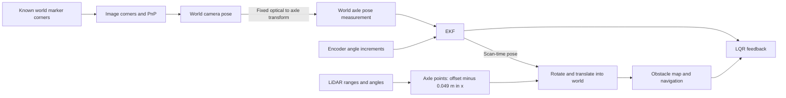

ArUco IDs select known marker corners. PnP and planar refinement estimate pose;
reprojection residuals above 3 pixels are rejected. The transform is
`T_WB = T_WC T_CB`, where `T_AB` maps coordinates from B to A. A LiDAR
point becomes `p_W = R(θ̂_scan)(p_L + [−0.049, 0]ᵀ) + p̂_scan`.
Using the scan-time estimate prevents later motion from displacing old returns.

Historical camera validation run 003 used **152 ideal rendered poses**, all
valid, with **9.35 mm position RMS**, **0.193° heading RMS** and **71.8 mm maximum
position error**. This validates the frame/pose implementation on that scene;
it does not calibrate real sensor noise or prove current-route coverage.
[Saved camera metrics](figures/camera_localisation/run_003/metrics.json).

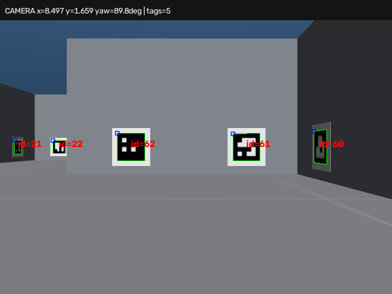
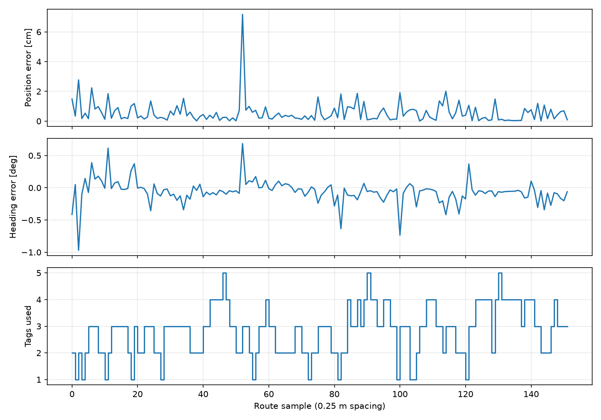

## Part C — State estimation

The EKF predicts pose from **measured encoder increments**, not wheel commands.
At 100 Hz it applies the constant-curvature motion model and propagates covariance:

```text
p̂_k⁻ = f(p̂_(k−1), Δs, Δθ)
P_k⁻ = F_k P_(k−1) F_kᵀ + Q
```

For a valid camera pose, `H = I`, `S = P⁻ + R`, `K = P⁻ S⁻¹` and
`p̂ = p̂⁻ + K(z − p̂⁻)`, with wrapped heading residual. The code uses
`P = (I − K)P⁻` and symmetrises it. Invalid images skip correction; encoders keep
predicting, so absolute drift cannot be removed until landmarks return.

Initial standard deviations are 0.3 m, 0.3 m and 10°. The initial estimate is
`(0.3, −2.0, 10°)` and is corrected by the first valid image. The current process
covariance, **per 0.01 s prediction**, is

```text
Q = 8 × diag(2.42388189 × 10⁻¹⁰,
             2.80857506 × 10⁻¹⁰,
             1.16930470 × 10⁻⁸)
```

The first two diagonal entries have units m² and the third rad². The base values
come from [one-step residual analysis](testing/figures/process_noise/run_002/calibration_002.json).
One deterministic run measures model residual variability, not a complete noise
distribution. The factor eight is empirical inflation to account for accumulated
drift. It must be reconsidered if the prediction interval changes.

Camera `R` uses the planar image-fit Jacobian, scaled by reprojection residual,
plus diagonal floors of **(0.02 m)², (0.02 m)² and (2°)²**. These floors and the
pixel-noise floor are assumptions, not fitted calibration results. Smaller `R`
increases camera influence; larger `Q` grows uncertainty faster and allows more
correction. Neither removes a biased motion model.

The saved tuning runs below explicitly record **ground-truth controller feedback,
with the EKF observing only**. They support tuning, not the assessed closed loop.
The Q multipliers and dropout periods were verified in their NPZ settings;
scene snapshots are not stored, so these are not a fully controlled comparison.

| Historical run | Position RMSE (mm) | Heading RMSE (°) | Heading inside ±2σ |
|---|---:|---:|---:|
| 1Q | 10.33 | 0.347 | 61.4% |
| 2Q | 7.46 | 0.296 | 79.2% |
| 4Q | 5.47 | 0.251 | 94.0% |
| 8Q | 4.12 | 0.211 | 100% |
| 4Q, camera outages | 39.23 | 0.529 | 82.8% |
| 8Q, camera outages | 31.93 | 0.461 | 100% |

Outages were 10–12, 25–30 and 45–65 s. Increasing Q improved these saved errors
and coverage, but 100% coverage alone is not proof of calibrated uncertainty.
The current closed-loop result below is less consistent near detours.


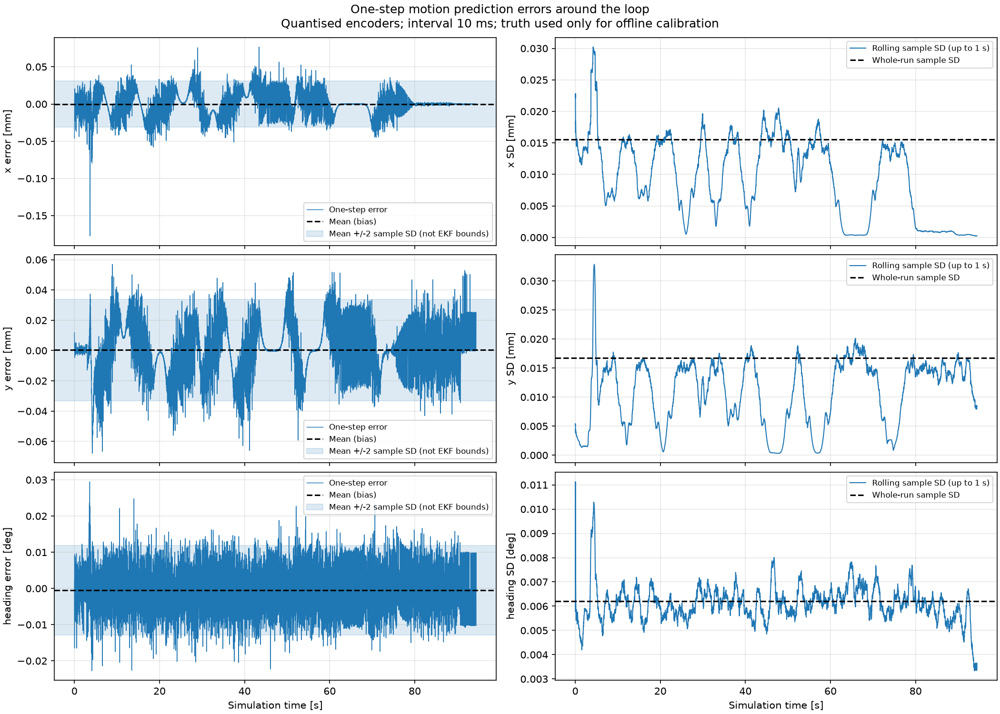

## Part D — Control

Trajectory tracking adapts the **Assessment 3 discrete LQR controller**. Its
cross-track and wrapped heading errors are retained, but the stadium-specific
path calculation is replaced by errors relative to the current planned route.
Both errors are calculated from the **EKF pose estimate**. Simulator truth is
reserved for evaluation.

The controller combines curvature feedforward with corrective state feedback:

```text
ω = vκ − K [ e_y ]
           [ e_θ ]
```

Feedforward supplies the nominal turning rate; feedback corrects lateral and
heading deviations. Following Assessment 3, the error model is discretised by
zero-order hold and the gain is calculated using `ct.dlqr`. The sample interval
is changed from **0.1 s to 0.01 s**, requiring a new discrete gain. The current
gain is designed on a straight at **0.6 m/s**; wheel limits can reduce the achieved
speed, so design-speed stability alone does not establish full-system performance.

The inherited weight scales are **0.02 m lateral error, 0.1 rad heading error and
0.26 rad/s corrective steering**, giving
`Q = diag(1/0.02², 1/0.1²)` and `R = 1/0.26²`.
Normalisation makes differently dimensioned errors comparable and expresses the
tracking-versus-steering trade-off. These are design scales, not demonstrated
error bounds. Closed-loop poles of `A_d − B_d K` are calculated as a local check.

Because lateral controllability is lost at rest, separate braking and heading
alignment modes handle stopped transitions. Docking uses camera-derived marker
position and orientation, reduced approach speeds and settled-motion checks
before declaring completion; marker loss returns to acquisition.

Supporting wheel PI loops convert speed targets into torque, with anti-windup
and **±0.5 N·m** limits. Their current gains, **Kp=0.25 and Ki=0.25**, were reduced
after excessive torque usage.

The calculated gain is `K = [12.6963, 4.6565]` and both design-model pole magnitudes
are **0.976635**, inside the unit circle. This checks the local unsaturated model,
not every avoidance transition. The 2 cm and 0.1 rad weight scales prioritise
lateral accuracy; the 0.26 rad/s scale penalises correction effort. A matched
weight sweep has not been saved, so these remain inherited starting choices
rather than demonstrated optimal weights.

The inverse wheel model is `Ω_L = (v − bω/2)/r; Ω_R = (v + bω/2)/r`. PI acts on wheel-speed
error, with conditional integration during torque saturation. Limits are
25 rad/s wheel speed and 2 rad/s body yaw. The ±0.5 N·m torque limit is a simulation
choice, not a verified motor rating. Zero-speed requests retain PI braking.

Docking uses marker 0 (0.20 m side) directly in the camera frame. The 0.414 m
axle-to-marker target combines 0.100 m camera offset and 0.314 m desired camera
depth from `assets/charging_station/station.json`. Approach speed is capped at
0.12 m/s, reducing near the station, followed by 40 seating updates at 0.015 m/s
and 10 settled updates. At 20 Hz these correspond to 2 s and 0.5 s. These are
empirical approach/settling choices; completion is camera-based, not a charge sensor.

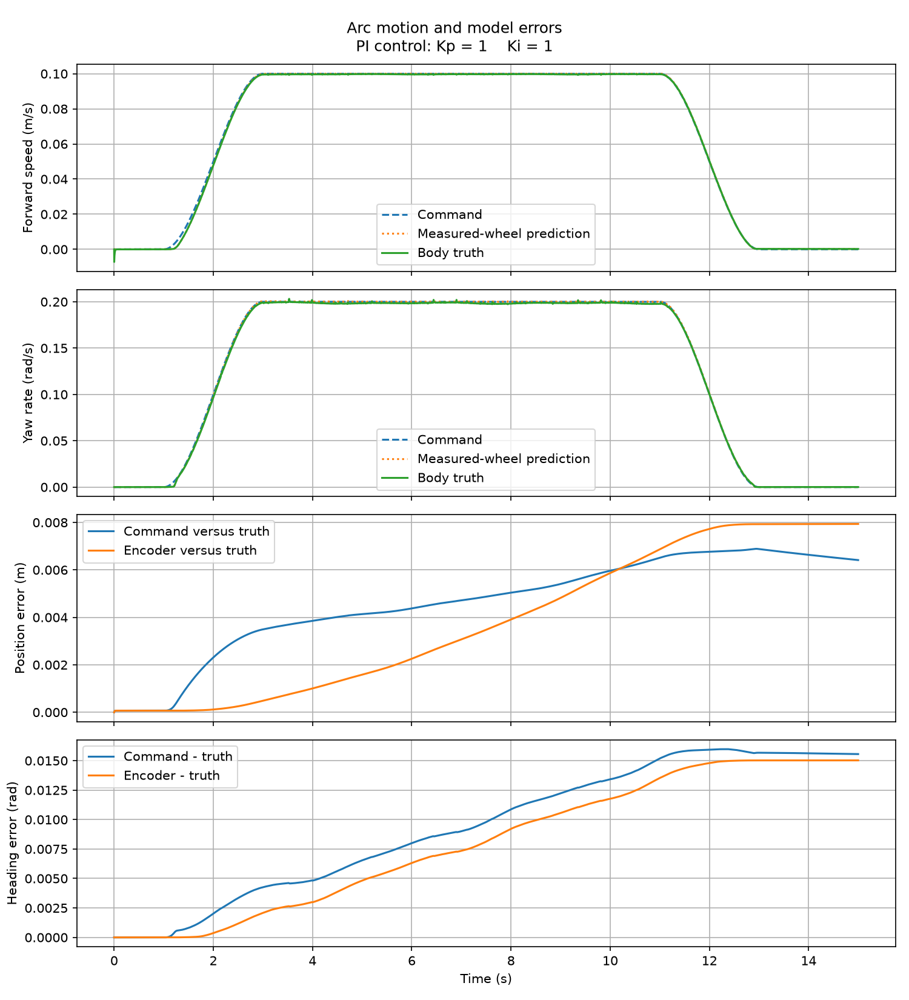

This historical arc plot uses **Kp=Ki=1**, not the final 0.25 gains. Command versus
measured wheel response isolates actuator tracking; encoder prediction versus
body truth checks the rolling model. The approximately 8 mm final encoder-model
position discrepancy illustrates why odometry needs camera correction.

## Part E — Integration, results and limitations

Motor testing exposed a simulation-model issue: rear-support portions of the
chassis collision mesh dragged against the floor, causing wheel rotation to
overpredict ground travel. A targeted chassis-floor contact pair now uses
sliding friction **0.01** as a caster approximation, preserving tyre and obstacle
friction. Following this correction, one historical component trial with wheel
gains **Kp=0.4, Ki=0.5** recorded **0.994 m encoder-predicted travel versus 0.991 m
actual net displacement**. This approximately 3 mm difference is a single
straight-motion diagnostic, not a route-tracking accuracy guarantee. Component
tests include smooth acceleration, a step increase and abrupt stopping;
numbered plots retain gain settings, speed errors, torque and rolling mismatch.

The known wall map is inflated by radius 0.25 m plus margin 0.12 m; A* and smoothing
provide the route. Cubes are excluded from that map. LiDAR predicts constant-command
motion over 1 s in 0.05 s increments. On a blockage, navigation brakes, confirms
wheel speeds below 0.015 m/s and 0.04 rad/s, maps one fresh scan, plans to a point
2 m ahead on the original route, and waits for three clear scans before moving.
It follows the open detour with the same LQR and restores original-route progress
at rejoin. Failed planning leaves the robot stopped.

### Current nominal trial — seed 42

The saved [nominal report](figures/submission/nominal) is from the current estimated
feedback pipeline. Two detours were planned, at original-route rejoin progress
33.39 m and 36.32 m, before completing the 38.37 m route and docking.
Cube side lengths were 0.377396 m and 0.385860 m. This is **one successful trial
out of one current full trial**, not a general reliability estimate.

| Measurement | Result |
|---|---:|
| Route and docking completed | Yes |
| Simulation duration | 104.16 s |
| Final truth position error relative to dock target | 19.63 mm |
| Final truth heading error relative to −90° target | 2.04° |
| Robot wall/cube contact physics steps | 0 |
| Robot station-contact physics steps | 1,822 |
| EKF position RMSE / maximum | 10.89 / 43.45 mm |
| EKF heading RMSE / maximum | 1.166 / 8.012° |
| Valid localisation images | 520 / 521 |
| Whole-run feedback cross-track RMS / maximum | 78.89 / 246.79 mm |
| Left / right torque clipping | 3.61 / 5.97% |

Sources: [controller metrics](figures/submission/nominal/controller_metrics_full_system.json),
[estimator metrics](figures/submission/nominal/estimator_metrics_full_system.json),
and [extracted run metadata](submission/nominal_metadata.json). Contacts count
physics steps, not separate impacts. The only contacted geom was
`dock_contact_-0.055`, supporting station seating rather than a wall/cube collision.

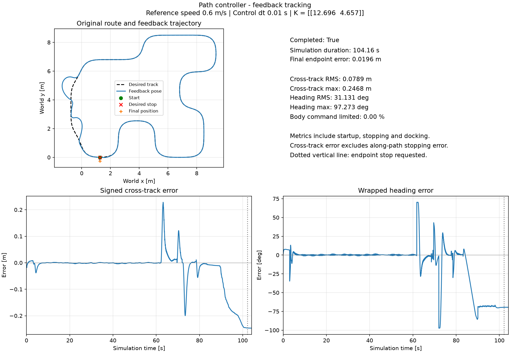

The blue line is **EKF feedback pose**. The dashed line is the original route; departures
on its left side are detours. Error panels use the active reference and include
startup, stopped transitions and deliberate docking departure. Consequently the
whole-run 78.89 mm RMS and 31.13° heading RMS are **not navigation-only tracking
accuracy**. Docking endpoint truth error is reported separately above.

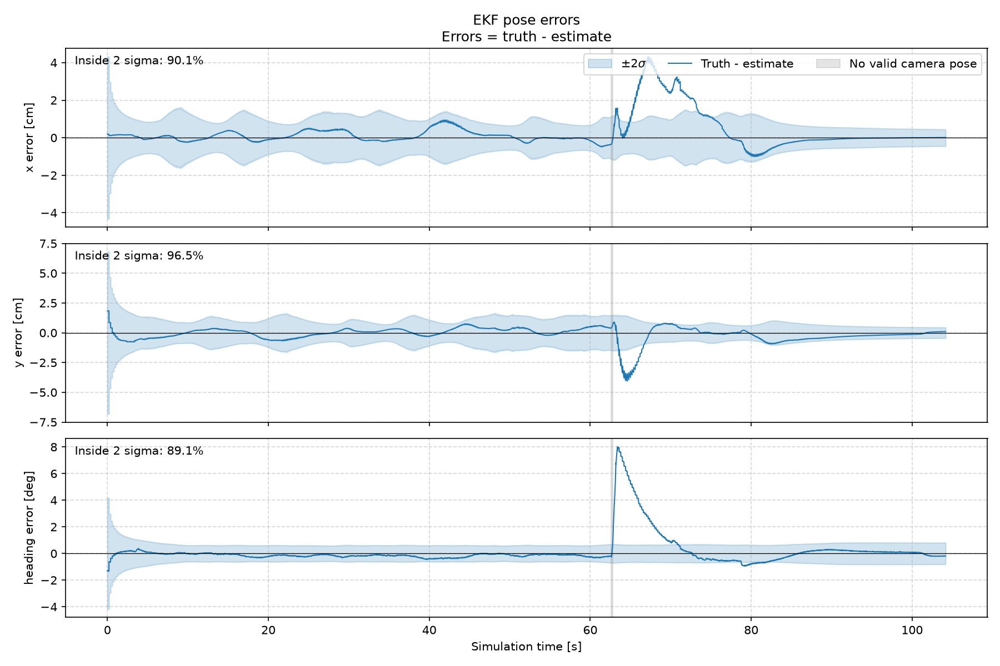

The largest heading transient appears near 63 s, followed by position error,
consistent with heading error accumulating through forward motion. Its cause
needs a focused replay of wheel response and camera residuals; this plot alone
does not distinguish slip from camera bias. Coverage is 90.1%, 96.5%, 89.1% for
x, y and heading. Mean NEES is **16.85** for three states, indicating overconfidence
in parts of this run. Low average NIS (**0.77**) does not remove that concern.

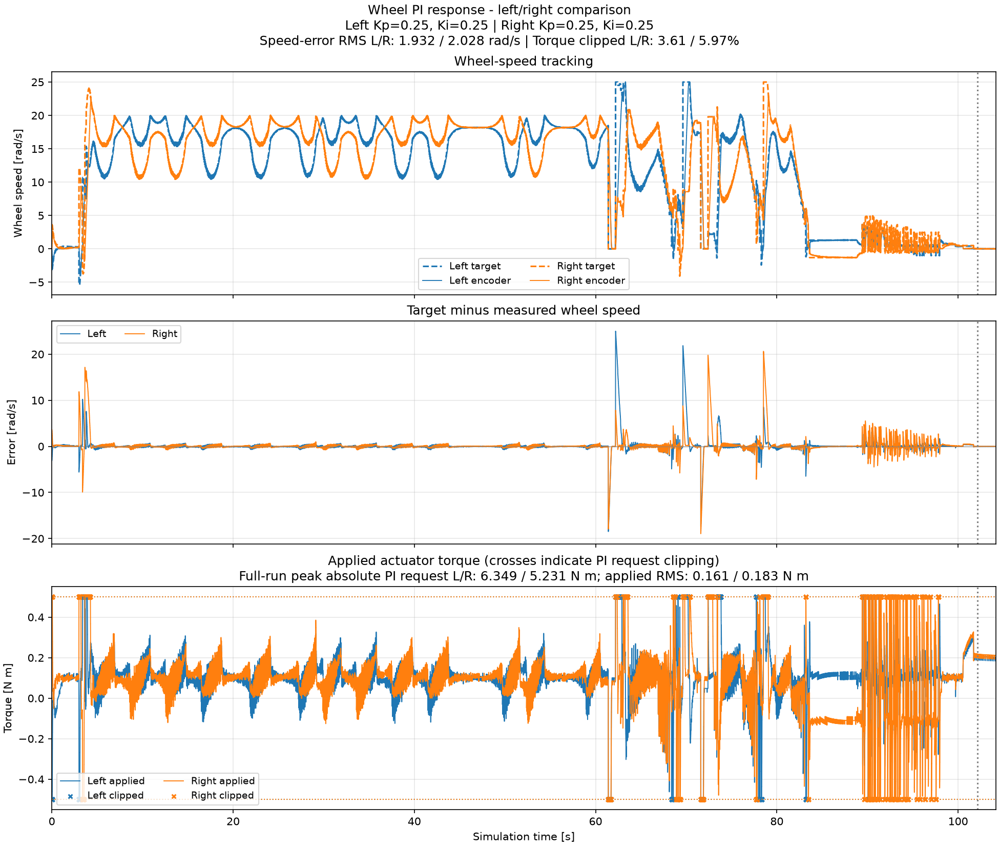

Torque clipping is limited but nonzero. This supports the feasibility of the
chosen PI gains on this route, not their optimality. Larger gains could reduce
lag while increasing saturation and quantisation-driven torque variation.

<details>
<summary>Supporting screenshots and diagnostics</summary>

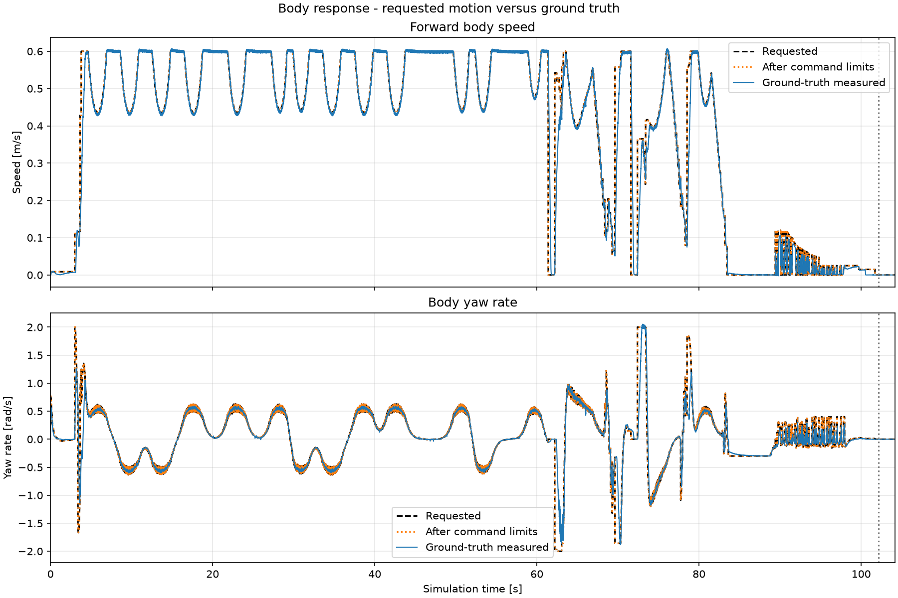
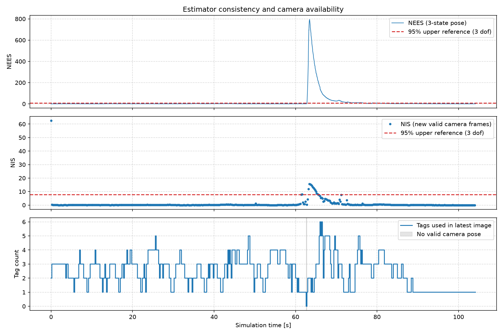
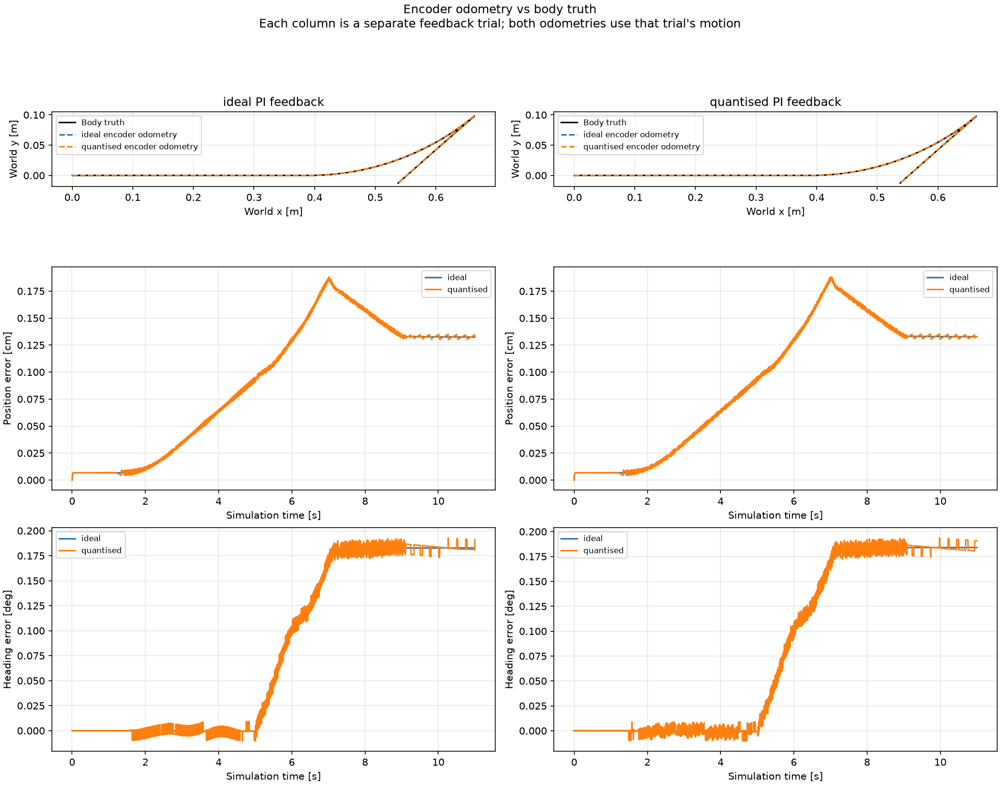
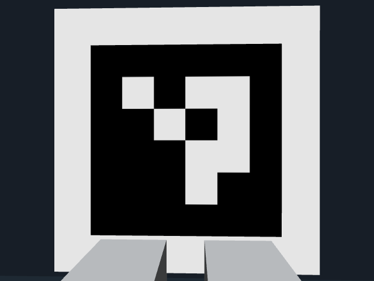
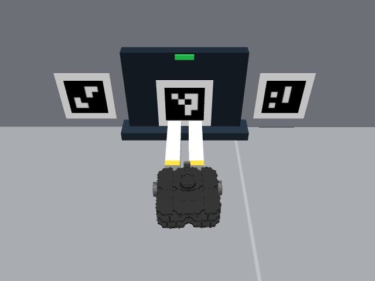

Docking photographs are **historical run 005**, not photographs of the new nominal
trial. Older loop-navigation checks used truth feedback. All saved experiment
families are indexed in [the evidence guide](submission/EVIDENCE.md).

</details>

### Current robustness trials

All three trials use the same gains and noise model. The outage trial changes
only localisation-image availability; the seed-43 trial changes cube geometry.
Each condition was run once. **3/3 completed**, but this small selected set is
not a statistical reliability claim.

| Trial | Time (s) | Dock position error (mm) | EKF position RMSE (mm) | EKF heading RMSE (°) | Wall/cube contact steps |
|---|---:|---:|---:|---:|---:|
| [Nominal, seed 42](figures/submission/nominal) | 104.16 | 19.63 | 10.89 | 1.166 | 0 |
| [Camera outages, seed 42](figures/submission/dropouts) | 105.48 | 20.49 | 88.40 | 0.925 | 0 |
| [Changed layout, seed 43](figures/submission/layout_43) | 102.06 | 17.34 | 7.74 | 0.653 | 0 |

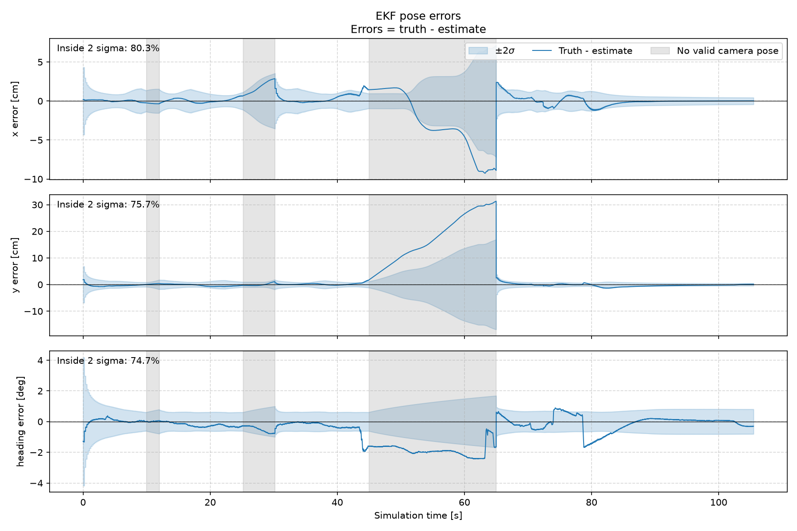

During the 45–65 s outage, y error accumulates to about 0.31 m; total position
error peaks at **0.326 m**. Camera return sharply corrects the estimate, and the
final position-estimation error is **1.30 mm**. The near-correct heading can still
integrate substantial position drift over 20 s of motion. Heading ±2σ coverage
falls to **74.7%**, so successful completion does not imply reliable uncertainty.
The smaller heading RMSE than the nominal trial reflects a different closed-loop
trajectory, not an advantage from removing the camera. Docking retains its separate
camera observations; this experiment does not test station-marker loss.

Seed 43 uses cube side lengths **0.365230 m and 0.302002 m**, compared with
0.377396 m and 0.385860 m for seed 42. Both layouts required two detours and had
zero unwanted contacts. This supports these two layouts only, not arbitrary
obstacle sizes or moving objects.

### Limits and next checks

The current collision circle is only **0.15 + 0.05 = 0.20 m**, smaller than the
planner's **0.25 + 0.12 = 0.37 m** envelope. A [geometry check](submission/footprint_check.txt) of the loaded model
found the chassis collision mesh extends **0.2192 m** from the axle in the XY
plane, already beyond the entire collision-check circle. The planner radius is
conservative for that mesh, but the motion check underestimates it. The next
change should test a radius of at least 0.22 m (or the planner's 0.25 m), plus a
separate margin, and rerun the same trials. Keep the current result as the
baseline. Braking clearance also needs measurement: at the 0.6 m/s reference
speed, one 0.2 s scan interval represents 0.12 m of travel before braking.

The map uses persistent scan endpoints: it cannot clear old noise, infer hidden
surfaces or handle moving obstacles. The single 2 m rejoin target may fail even
when another path exists. Camera noise floors, LiDAR noise and docking thresholds
also need independent validation. The current varied trials support completion
under the tested conditions, while exposing uncertainty underestimation. Further
trials should target the observed detour transient and stopping clearance, rather
than adding more features.

## Repository guide

| Location | Contents |
|---|---|
| `scripts/` | Robot interface, estimation, planning, navigation, control and evaluation |
| `robotis_tb3/` | TurtleBot3 models, navigation scene and landmark map |
| `assets/` | Supporting visual assets, including localisation markers |
| `testing/` | Component checks, validation scripts and calibration experiments |
| `figures/` | Saved plots, numerical logs and evaluation metrics |
| `requirements.txt` | Python dependency versions |

The assessed demonstration entry point is **`scripts/main.py`**. Separate
experiments are supporting material. Unused UR3 examples, old entry points and
unused path implementations were removed from this submission tree; used model
assets, licences, tests and historical results were retained.

## Individual contributions

| Team member | Contribution |
|---|---|
| Harrison Braund | Controller design; estimator and Kalman filter; encoder noise model; LiDAR and navigation logic |
| Noah Pereira | Map construction; ArUco markers; robot integration; path planning |

## Acknowledgements and sources

This project uses MuJoCo, the TurtleBot3 model assets, OpenCV and the Python
Control Systems Library, together with the other packages listed in
`requirements.txt`. Retain the supplied licences for third-party assets and
code.

Assessment 3 supplied the unicycle propagation, local tracking-error model,
ZOH/discrete LQR and EKF design approach. Here encoder motion replaces command
prediction, camera pose replaces UWB range observations, and a mapped route and
detours replace the stadium reference. Week 6 optimal-control, Week 8 estimation
and Week 9 visual-servoing materials were supporting theory references.

## Generative AI declaration

ChatGPT and OpenAI Codex were used for project planning, technical explanations,
code review, debugging, selected implementation changes, simulation checks and
documentation drafting. This included assistance with the obstacle-size fix,
reviewing saved evaluation results, preparing this README and video script,
organising evidence, removing unused examples, correcting diagnostic logging
and running the nominal simulation. AI-assisted explanations were checked against
the code and saved data; unverified tuning assumptions are labelled above.


